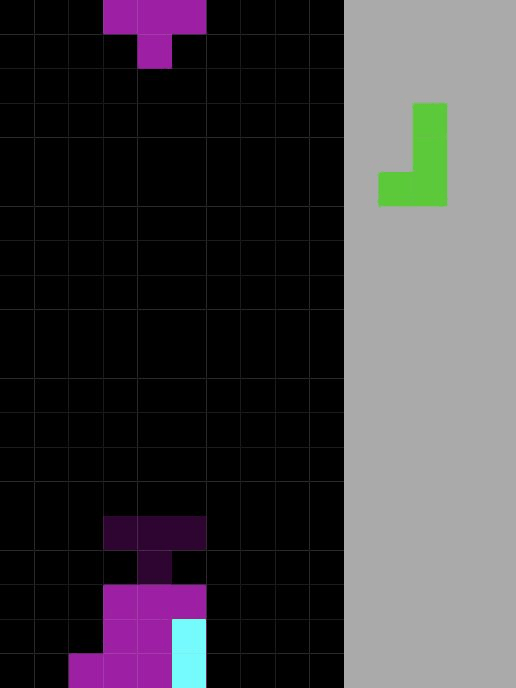

# Tetris Bot

A CS340: Intro to Computer Systems final project at UIUC, Spring 2025, combining a browser-based Tetris game with a heuristic game-playing bot.

## Overview

  

## Features

- Asynchronous game communication using aiohttp and WebSockets.
- Search over candidate piece rotations and horizontal placements.
- Heuristic board evaluation using completed lines, holes, stack height, and surface unevenness.
- Browser interfaces for playing and observing games.

## Structure

- `mp10/`: Tetris game service, browser interface, and tests.
- `projection/`: Bot implementation, scoring logic, and supporting interfaces.

## Approach

The bot simulates candidate placements, scores the resulting boards, and selects a move sequence. Its evaluation rewards completed lines and penalizes holes, excessive height, and uneven stacking.
